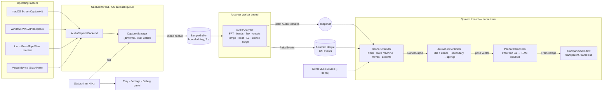

# Architecture

Project EVE is a single Python process with three threads of work and a strict
one-directional data flow: **system audio → analysis → choreography → animation →
rendering → desktop window**. Every stage depends only on the data type produced by the
stage before it, so any stage can be replaced without touching the others.

## Components

| Package | Responsibility | Knows about |
|---|---|---|
| `setup/` (repo root) | First-time setup & launch: OS/Python detection, venv, pinned install, validation, progress. Standard library only. | nothing in `src/` except `eve.storage.paths` |
| `eve.audio` | System-audio capture backends, capture manager (status, retries), bounded sample buffer, streaming analysis (spectrum, onsets, tempo, beats, silence, surges). | NumPy, OS audio APIs (platform modules only) |
| `eve.audio.platforms` | ScreenCaptureKit (macOS), WASAPI loopback (Windows), PulseAudio/PipeWire monitors (Linux), virtual loopback device fallback (macOS). | `capture_interface` only |
| `eve.dance` | Music-aware choreography: dance state machine, movement library, selection with history/cooldowns, crossfades, musical clock, accents. Also the `--demo` virtual song. | `AudioFeatures`, `PulseEvent`, rig channels |
| `eve.animation` | Layered pose controller: idle life, dance layer, secondary motion, damped springs, blink. | `DanceOutput`, rig channels |
| `eve.character` | Rig definition (`Ch` channels), procedural NumPy geometry, materials, expressions, Panda3D scene-graph builder (`eve_character.py`). | Panda3D (builder only) |
| `eve.rendering` | `CharacterRenderer` interface; Panda3D offscreen implementation; shaders; camera framing. | Panda3D, `character` |
| `eve.desktop` | Platform capabilities, window flags/placement, tray icon, drawn icons. | Qt |
| `eve.ui` | Companion window (paints frames, drag/click/menu), settings window, status widget, debug panel. | Qt, `AppController` protocol, `FrameImage` |
| `eve.storage` | Storage paths (stdlib), versioned JSON settings with migrations and recovery. | stdlib |
| `eve.application` | Composition root: builds everything, owns timers and lifecycle, implements `AppController`. | everything |

Boundaries that are deliberately enforced:

* The analyzer never knows where samples came from (`SampleBuffer` is the only input).
* The dance controller never imports rendering or capture code.
* The renderer never touches audio; the window never imports Panda3D.
* The UI talks to the app only through `eve.app_context.AppController`.

## Data flow

## Threading model

| Thread | Work | Communication |
|---|---|---|
| Capture (SoundCard recorder thread, or ScreenCaptureKit's dispatch queue) | Receive OS buffers, convert to mono float32, track level, write to `SampleBuffer`. | `SampleBuffer.write` (lock + condition). Status via a lock-protected field. |
| `eve-analyzer` | Block on `SampleBuffer.read_into(hop)`, run `AudioAnalyzer.process_hop`, publish. | Latest features: atomic reference swap. Events: `deque(maxlen=128)` (thread-safe append/popleft). |
| Qt main thread | Frame timer (dance → animation → render → paint) and a 250 ms status timer (`CaptureManager.poll`, UI refresh). | Reads snapshot + drains events; never waits on audio. |

Rules: no unbounded queues (ring buffer drops oldest and counts overruns; event deque has
a max length); no thread creation per frame; every thread is joined on shutdown.

## Interfaces

* `AudioCaptureBackend` (`eve/audio/capture_interface.py`): `start_capture(source_id)`,
  `stop_capture()`, `get_status()`, `get_supported_sources()`, `dispose()`,
  classmethod `availability()`; delivers `on_samples(samples, rate)` and
  `on_status(CaptureStatusInfo)`.
* `CaptureManager`: chooses a backend, validates real sample arrival, retries.
* `AudioFeatures` / `PulseEvent` (`eve/audio/audio_features.py`): the analysis contract.
* `DanceController.update(dt, features, age, events) -> DanceOutput`.
* `AnimationController.update(dt, DanceOutput) -> pose (np.ndarray[Ch])`.
* `CharacterRenderer` (`eve/rendering/renderer_interface.py`): `initialize`, `resize`,
  `render(pose) -> FrameImage`, `dispose`.
* `AppController` (`eve/app_context.py`): what UI widgets may call.

## Platform-specific boundaries

Only these modules contain OS-specific code:
`eve/audio/platforms/*`, `eve/desktop/platform_capabilities.py`,
`eve/desktop/window_manager.py` (macOS tool-window attribute), `eve/storage/paths.py`,
`setup/*`, and the three launchers. See [cross-platform-support.md](cross-platform-support.md).

## Error handling

* Capture: backends report `CaptureStatus` values; the manager verifies samples really
  arrive (`RECEIVING_AUDIO` vs `NO_AUDIO_DETECTED`), auto-retries recoverable failures
  (`DEVICE_UNAVAILABLE`, `ERROR`) with 2→30 s backoff, and never auto-retries
  `PERMISSION_DENIED` (the user must act; there is a Retry button). There is no
  microphone fallback anywhere.
* Callbacks from native threads are wrapped so exceptions never propagate into
  Objective-C or the audio driver.
* Renderer failure at startup shows a dialog and exits with code 4.
* Shutdown runs through `core.lifecycle.ShutdownSequence`: reverse order, continues past
  failures, idempotent.
* Settings: invalid values are clamped/defaulted, corrupt files quarantined, newer-version
  files left untouched.

## Settings and storage

`eve.storage.paths.resolve_paths()` gives per-user locations (see
[setup-and-installation.md](setup-and-installation.md#where-things-are-stored)). Settings
are a versioned JSON document (`eve.config.Settings`, `SETTINGS_VERSION`), migrated by
`eve.storage.migrations`, written atomically. Logs rotate at 1 MB × 3. Nothing is stored
inside the repository or the venv except the venv's install marker.
